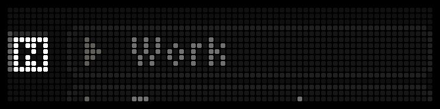

# Tasks for Notion

Browse your Notion from a [BUSY Bar](https://busy.bar) and tick tasks off with its buttons.



The bar shows Notion the way its sidebar does: your top-level pages, then whatever a page holds, its
subpages, the databases inside it and its to-dos, in the page's own order. Turn the wheel to move, press
**OK** to open a page or to tick a task off. A ticked task stays where it is, as in Notion, with a burst
of confetti. Press **OK** again to untick it.

The bar talks to the Notion API itself, over its own Wi-Fi. No computer, server or proxy is involved:
your token and your tasks go only between the bar and `api.notion.com`.

## Install

You need a BUSY Bar on firmware **1.3.1 or newer**, connected to Wi-Fi, and a Notion account.

1. Download `app.avachadev.notiontasks.tgz` from the
   [latest release](https://github.com/avachadev/busybar-notion-tasks/releases/latest).
2. Open the bar's web interface: `http://10.0.4.20` when the bar is plugged in by USB, or the bar's IP
   address on Wi-Fi. Go to **Apps → Add app** and pick the file.
3. Create a Notion token (see below) and paste it into **Apps → Tasks for Notion → Notion token**.

Your top-level pages appear on the bar a few seconds later.

### Getting a token

Either of these works.

- **A personal access token** is the quickest. In Notion's Developer portal open **Personal access
  tokens → New token**, give it access to the Notion API and copy the token
  ([Notion's guide](https://developers.notion.com/guides/get-started/personal-access-tokens)). It sees
  everything you can see, with nothing to share. Depending on your plan, only workspace owners may be
  allowed to create one.
- **An internal connection** sees only the pages you share with it, which makes it the safer choice.
  Create the connection in the Developer portal with *Read content* and *Update content*, copy its API
  token, then in Notion open the page you want on the bar and add the connection under **••• →
  Connections**. Subpages are shared along with it.

## Using it

| Control | What it does |
| --- | --- |
| Wheel | Moves through the entries. The focused one sits in the middle of the screen. |
| **OK** or **Start** | Opens a page or a database. On a task, ticks it off or back on. |
| **Back** | Goes up a level. On the top level, leaves the app. |
| Long **Back** | Leaves the app from anywhere. |

| Entry | Looks like |
| --- | --- |
| Page | An arrow ▸ |
| Database | A small grid |
| Open task | An empty checkbox, dimmed text |
| Ticked task | A blue checkbox, highlighted row, white text |

A tick goes to Notion 1.5 seconds after the press; a second press within that time takes it back
without any request. Leaving the page sends the ticks made on it right away.

The open page is read again every minute, and the top-level pages every ten minutes. The app remembers
where you were and what every level of the way showed, so it opens there at once and going back up
needs no waiting, even after a restart.

### Databases

A database shows its open rows that are due today or earlier, soonest first, then the rows ticked off
today, so a task closed by mistake can be reopened. The app finds the properties by itself:

- **Done**: a checkbox named like *Done*, *Complete* or *Finished* (or its Russian equivalent); else a
  status property, where any option in its *Complete* group means done; else any checkbox.
- **Due date**: a date property named like *Due* or *Date*; else the first date property. A database
  without one shows all open rows.

Unticking a status row sets it back to the status's default option. Notion has no "closed at" date,
so "ticked off today" means a done row edited since midnight by the bar's clock.

## Settings

| Setting | What it does |
| --- | --- |
| **Notion token** | The personal access token or the connection's token. |
| **Start page** | Optional. Leave it empty to start from your top-level pages, or paste a link to a page or a database (**••• → Copy link** in Notion) to start there. |
| **Show** | For databases with a date: *Due today and overdue* (the default) or *All open tasks*. Pages always show every to-do. |

Changes apply within a few seconds, without restarting the app.

## What the bar may say

| Screen | Meaning |
| --- | --- |
| `Set token` | No token in the settings yet. |
| `Bad token` | Notion does not accept the token: it was mistyped, revoked or has expired. |
| `No pages` | The token sees nothing. An internal connection needs pages shared with it. |
| `No access` | The page or database is not shared with the token, or it was deleted. |
| `No checkbox` | The database has no checkbox or status property to tick. |
| `Offline` | Notion could not be reached. The app keeps trying, waiting longer each time. |
| `All done` | The database has nothing left for today. |

## Security

**Anyone who can open the bar's web interface can read the token**: the bar's settings have no hidden
fields, and its HTTP API serves them to the local network. To keep it to yourself:

- set a password on the bar's HTTP API (**Network → HTTP API** in the web interface);
- prefer an internal connection shared with just the pages you need, over a personal access token;
- revoke the token in Notion if the bar changes hands.

The token is never written anywhere else by the app: what it saves on the bar for a quick start is the
path you were on and the titles shown there.

## Limits

- Notion's API has no call for the sidebar, so the top-level pages are picked out of a search of up to
  100 pages. In a large workspace some may be missing; set a **Start page** then.
- A page shows its first 200 blocks. To-dos nested inside toggles or columns are not shown.
- A database shows up to 20 rows.
- Each request to Notion takes the bar a few seconds. Scrolling stays quick, but may stutter for a
  moment while a fresh answer is being read.

## How the screen is drawn

The layout follows the BUSY Bar Figma design `notion_frontscreen_tasks_list`. The app's 8×8 icon sits
at the left edge of every screen. Entries are 9 px rows, 10 px apart, with the focused one in the
middle on rows 3–11 and its neighbours cut by the screen's edges. Row backgrounds and checkboxes are
PNGs from the design, under `src/images`; the rows were cut to 62 px in their flat middle to make room
for the icon. Text is in the bar's `small` font, so Cyrillic titles work too.

The confetti is three pre-rendered animations, played by the bar itself at 30 fps: a burst, a fountain
and streamers. Each tick plays one of them, never the same twice in a row. To change them, edit
`tools/confetti.py`, then rebuild each one with the converter from the
[BUSY Bar firmware](https://github.com/busy-app/busybar-firmware):

```bash
python3 tools/confetti.py burst confetti_burst.zip
PYTHONPATH=<firmware>/scripts python3 <firmware>/scripts/seq2anim.py -o src/animations/confetti_burst.anim confetti_burst.zip
```

## Development

Requires Node 24 (Node 26 is not supported).

```bash
npm install
npm run typecheck
npm test
npm run build                                  # dist/app.avachadev.notiontasks.tgz
npm run app:install                            # install on the bar connected over USB
npm run app:run
```

Over Wi-Fi add `-- --addr <bar-ip>` (and `--password <password>` if the bar has one). Do not pass
`--addr` to `npm run build`: it changes the address the app itself talks to, which must stay `localhost`.

| Path | What it is |
| --- | --- |
| `src/main.ts` | Entry point: navigation, ticking, refreshes, drawing, the buttons. |
| `src/source.ts` | Reads a view (the top level, a page or a database) and ticks tasks in Notion. |
| `src/tasks.ts` | Turns Notion's answers into entries; finds a database's properties; builds queries. |
| `src/notion.ts` | The Notion API client: one `fetch` per call, errors as `NotionError`. |
| `src/link.ts` | Turns a pasted Notion link into an id. |
| `src/config.ts` | Reads the settings. |
| `src/cache.ts` | Keeps the path and what it showed in `localStorage`. |
| `src/screen.ts`, `src/layout.ts` | Display elements and geometry. |
| `src/display.ts` | Draws through the bar's local HTTP API. |
| `src/images`, `src/animations` | Images from the design; the confetti. |
| `tools/confetti.py` | Renders the confetti frames. |
| `test/` | Unit tests, run with Node's built-in test runner. |

Releases are built by GitHub Actions: push a tag equal to the version in `src/appmeta/manifest.json`
(e.g. `1.0.0`) and the workflow attaches `app.avachadev.notiontasks.tgz` to the release.

## License

[MIT](LICENSE). Notion is a trademark of Notion Labs, Inc. This app is not affiliated with Notion.
