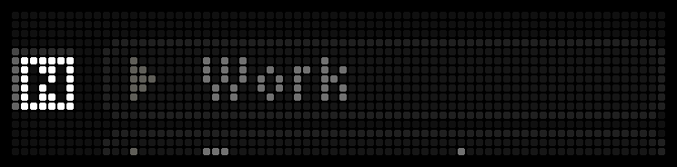

# Tasks for Notion

Browse your Notion from a [BUSY Bar](https://busy.bar) and tick tasks off with its buttons.



The bar shows Notion the way its sidebar does: your top-level pages and databases, then whatever a page
holds, its subpages, the databases inside it, its toggles, headings and to-dos, in the page's own
order. To-dos nested under other to-dos and inside toggles are indented; what is in columns, callouts,
quotes, synced blocks and lists shows in place. Turn the wheel to move, press **OK** to open a page,
to open or close a toggle, or to tick a task off. A ticked task stays where it is, as in Notion, with a burst
of confetti. Press **OK** again to untick it.

The bar talks to the Notion API itself, over its own Wi-Fi. No computer, server or proxy is involved:
your token and your tasks go only between the bar and `api.notion.com`.

## Install

You need a BUSY Bar on firmware **1.4.1 or newer**, connected to Wi-Fi, and a Notion account.

1. Download `app.avachadev.notiontasks.tgz` from the
   [latest release](https://github.com/avachadev/busybar-notion-tasks/releases/latest).
2. Open the bar's web interface: `http://10.0.4.20` when the bar is plugged in by USB, or the bar's IP
   address on Wi-Fi. Go to **Apps → Add app** and pick the file.
3. Create a Notion token (see below) and paste it into **Apps → Tasks for Notion → Notion token**.

Your top-level pages appear on the bar a few seconds later.

### Getting a token

Either of these works.

- **A personal access token** is the quickest. In Notion's Developer portal open **Personal access
  tokens → New token**, give it access to the Notion API and copy the token
  ([Notion's guide](https://developers.notion.com/guides/get-started/personal-access-tokens)). It sees
  everything you can see, with nothing to share. Depending on your plan, only workspace owners may be
  allowed to create one.
- **An internal connection** sees only the pages you share with it, which makes it the safer choice.
  Create the connection in the Developer portal with *Read content* and *Update content*, copy its API
  token, then in Notion open the page you want on the bar and add the connection under **••• →
  Connections**. Subpages are shared along with it.

## Using it

| Control | What it does |
| --- | --- |
| Wheel | Moves through the entries, passing over headings. The focused one sits in the middle of the screen. |
| **OK** or **Start** | Opens a page or a database. Opens or closes a toggle in place. On a task, ticks it off or back on. |
| **Back** | Goes up a level. On the top level, leaves the app. |

| Entry | Looks like |
| --- | --- |
| Open task | A plate, an empty checkbox, white text |
| Ticked task | A highlighted plate, a blue checkbox, faded text |
| Page | No plate; a sheet on the left, a chevron › on the right |
| Database | No plate; a grid on the left, a chevron › on the right |
| Toggle | No plate; ▸ closed, ▾ open, the number of open tasks inside on the right. Toggles start closed. |
| Heading | Grey text, no mark; the focus passes over it |

A page, a database or a toggle that is not focused is grey, marks included, as the neighbours in the
bar's APPS menu are: it shows there is more without drawing the eye. Tasks keep their look.

Lines stack by their height: a task's plate is 9 px, a line without one 7 px (its letters and 1 px
above and below), 1 px apart, so a list of pages sits tighter than a list of tasks. Each level of
nesting moves a line 2 px right, up to three levels. An empty to-do is not shown; the
to-dos under it take its place. Plain paragraphs are not shown.

A tick goes to Notion 1.5 seconds after the press; a second press within that time takes it back
without any request. Leaving the page sends the ticks made on it right away. A tick that does not get
through is sent twice more; if it still fails, the bar says `Not saved` and the task shows what Notion has.

The open page or database is read again every 5 seconds, once the wheel has been still for 2 seconds:
a task ticked off in Notion is ticked off on the bar within seconds. On the top level, a search for what
was edited last runs every 15 seconds, so a new page shows within half a minute; the whole top level is
read again every ten minutes. The app remembers
where you were and what every level of the way showed, so it opens there at once and going back up
needs no waiting, even after a restart.

### Databases

A database shows its open rows that are due today or earlier or have no date, soonest first, then the
rows ticked off today, so a task closed by mistake can be reopened. The app finds the properties by itself:

- **Done**: a checkbox named like *Done*, *Complete* or *Finished* (or its Russian equivalent); else a
  status property, where any option in its *Complete* group means done; else a select with an option
  named like *Done*; else any checkbox. A database with several data sources uses the first one that
  has one of these.
- **Due date**: a date property named like *Due* or *Date*; else the first date property. A database
  without one shows all open rows.

Unticking a status row sets it back to the status's default option, a select row to its first option
that is not done. Notion has no "closed at" date,
so "ticked off today" means a done row edited since midnight by the bar's clock.

## Settings

| Setting | What it does |
| --- | --- |
| **Notion token** | The personal access token or the connection's token. |
| **Start page** | Optional. Leave it empty to start from your top-level pages, or paste a link to a page or a database (**••• → Copy link** in Notion) to start there. |
| **Show** | For databases with a date: *Due today, overdue or undated* (the default) or *All open tasks*. Pages always show every to-do. |
| **Notion logo** | Off by default. On: the Notion logo at the left of the screen, for photos and videos. |

Changes apply within a few seconds, without restarting the app.

## What the bar may say

| Screen | Meaning |
| --- | --- |
| `Set token` | No token in the settings yet. |
| `Bad token` | Notion does not accept the token: it was mistyped, revoked or has expired. |
| `No pages` | The token sees nothing. An internal connection needs pages shared with it. |
| `No access` | The page or database is not shared with the token, or it was deleted. |
| `No checkbox` | The database has no checkbox or status property to tick. |
| `Offline` | Notion could not be reached. The app keeps trying, waiting longer each time. |
| `Notion busy` | Too many requests: the app waits as long as Notion asks. |
| `Notion down` | Notion answers with a server error. The app keeps trying. |
| `Notion error` | Notion refused the request; the second line is its error code. |
| `Not saved` | A tick did not reach Notion after three tries. |
| Orange dot in the top right corner (above the logo, with the logo on) | The list is from the last good read; the latest one failed. |
| `All done` | The database has nothing left for today. |

## Security

**Anyone who can reach the bar's HTTP API can read the token**: the web interface hides it, but the
API serves the settings to the local network as they are. To keep it to yourself:

- set a password on the bar's HTTP API (**Network → HTTP API** in the web interface);
- prefer an internal connection shared with just the pages you need, over a personal access token;
- revoke the token in Notion if the bar changes hands.

The token is never written anywhere else by the app: what it saves on the bar for a quick start is the
path you were on and the titles shown there.

## Limits

- Notion's API has no call for the sidebar, so the top level is picked out of searches of up to 100
  pages and 30 databases. In a large workspace some may be missing; set a **Start page** then.
- A page is read in one request, as Notion's markdown. A to-do whose text appears once on the page is
  ticked in one request too. One whose text repeats, or that sits in a synced block copied from another
  page, needs the page's blocks walked first: on a page with many toggles the first such tick takes
  some seconds; later ones on the page do not.
- A linked view of a database is not opened: open the database it shows.
- A database shows up to 20 rows.
- Each request to Notion takes the bar 1.3-1.7 seconds. Reads wait while the wheel turns, so scrolling
  stays quick.
- Notion's webhooks need a public server, and the bar takes no incoming connections, so the bar asks
  Notion itself every few seconds.

## How the screen is drawn

The layout follows the BUSY Bar Figma design `notion_frontscreen_tasks_list`. Entries are 9 px rows,
10 px apart, the whole width of the screen, with the focused one in the middle on rows 3–11 and its
neighbours cut by the screen's edges. With the **Notion logo** setting on, the app's 8×8 icon sits at
the left edge and the rows start 2 px right of it, 10 px shorter in their flat middle. Row backgrounds
and checkboxes are PNGs from the design, under `src/images`. Text is in the bar's `small` font, so Cyrillic titles work too.

The confetti is three pre-rendered animations, played by the bar itself at 30 fps: a burst, a fountain
and streamers. Each tick plays one of them, never the same twice in a row. To change them, edit
`tools/confetti.py`, then rebuild each one with the converter from the
[BUSY Bar firmware](https://github.com/busy-app/busybar-firmware):

```bash
python3 tools/confetti.py burst confetti_burst.zip
PYTHONPATH=<firmware>/scripts python3 <firmware>/scripts/seq2anim.py -o src/animations/confetti_burst.anim confetti_burst.zip
```

## Development

Requires Node 24 (Node 26 is not supported).

```bash
npm install
npm run typecheck
npm test
npm run build                                  # dist/app.avachadev.notiontasks.tgz
npm run app:install                            # install on the bar connected over USB
npm run app:run
```

Over Wi-Fi add `-- --addr <bar-ip>` (and `--password <password>` if the bar has one). Do not pass
`--addr` to `npm run build`: it changes the address the app itself talks to, which must stay `localhost`.

| Path | What it is |
| --- | --- |
| `src/main.ts` | Entry point: navigation, ticking, refreshes, drawing, the buttons. |
| `src/source.ts` | Reads a view (the top level, a page or a database) and ticks tasks in Notion. |
| `src/markdown.ts` | Turns a page's markdown into entries, to-dos in toggles, columns and the rest included. |
| `src/tasks.ts` | Turns Notion's answers into entries; finds a database's properties; builds queries. |
| `src/notion.ts` | The Notion API client: one `fetch` per call, errors as `NotionError`. |
| `src/link.ts` | Turns a pasted Notion link into an id. |
| `src/config.ts` | Reads the settings through the bar's local HTTP API. |
| `src/cache.ts` | Keeps the path and what it showed in `localStorage`. |
| `src/screen.ts`, `src/layout.ts` | Display elements and geometry. |
| `src/display.ts` | Draws through the bar's local HTTP API. |
| `src/images`, `src/animations` | Images from the design; the confetti. |
| `tools/confetti.py` | Renders the confetti frames. |
| `test/` | Unit tests, run with Node's built-in test runner. |

Releases are built by GitHub Actions: push a tag equal to the version in `src/appmeta/manifest.json`
(e.g. `1.0.0`) and the workflow attaches `app.avachadev.notiontasks.tgz` to the release.

## License

[MIT](LICENSE). Notion is a trademark of Notion Labs, Inc. This app is not affiliated with Notion.
